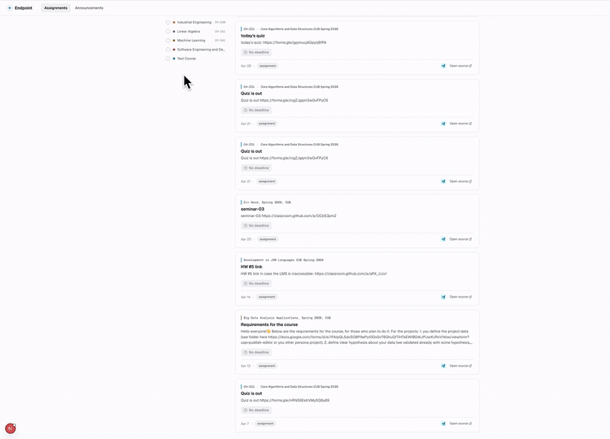

# Endpoint

**Archived project · public portfolio snapshot.** This repository contains a
sanitized snapshot of Endpoint's source code, selected documentation, pitch, and demo. The
project was developed in a private repository, so its earlier commit history
is not included here. Original messages, evaluation data,
production seeds, database snapshots, and credentials are excluded.

Endpoint is a unified academic information platform for Constructor University.
It aggregates course-relevant content from Microsoft Teams, Moodle, and Telegram,
processes it into normalized academic items, and presents students with a single
dashboard for assignments, announcements, events, materials, preferences, and
read state.

The repository is a monorepo for the full product: ingestion, processing, shared
schema, presentation API, student frontend, operator dashboard, Docker
orchestration, and production-seed tooling.

**Contents**

- [Problem and proposal](#problem-and-proposal)
- [Product definition and MVP scope](#product-definition-and-mvp-scope)
- [Architecture and stack](#architecture-and-stack)
- [Testing and evaluation](#testing-and-evaluation)
- [Presentation and demo](#presentation-and-demo)

## Problem and proposal

Endpoint addresses a problem identified in the [original proposal](docs/artifacts/proposal/proposal-v1.md):
Constructor University students receive assignments, announcements, and course
materials across several platforms and must piece together what matters for
each course.

The project brings content from Microsoft Teams, Moodle, and
Telegram into one student dashboard. Its ingestion and processing pipeline
turns source content into structured academic items that students can browse
by course and trace back to the original platform.

## Product definition and MVP scope

The team translated the proposal into [student user stories and system
requirements](docs/artifacts/specs/specs-v2.2.md), prioritizing what students
needed to see and how content from different platforms should be handled. The
[MVP scope](docs/artifacts/design-docs/mvp-design-v1.md) then focused the first
release on the ingestion and processing pipeline and unified assignment and
announcement views. It explicitly deferred features such as notifications,
daily briefings, and a calendar so the core flow could be built and evaluated
first.

## Architecture and stack

Endpoint's main data flow runs through three backend services: ingestion,
processing, and the presentation API. Ingestion collects content from Teams,
Moodle, and Telegram and stores source items for processing. The processor
independently classifies, normalizes, and deduplicates them; the presentation
API serves the resulting academic items to the student app. This separation
lets platform syncs continue while slower classification catches up. The
[architecture document](docs/artifacts/design-docs/architecture.md) shows the
services and data flow.

The backend uses Python, PostgreSQL, a shared Django ORM schema, and Django
REST Framework. The student app uses Next.js and TypeScript, and Docker
Compose runs the services together. The
[component structure](docs/COMPONENT_STRUCTURE.md) maps each part to the
repository.

## Testing and evaluation

Component tests cover ingestion, processing, the shared schema, the API, and
the student app. The ingestion daemon has a separate end-to-end suite, while
processor tests exercise persistence and failure paths against PostgreSQL.
The [component checks](scripts/run_component_checks.sh) run the applicable
lint, type, test, and build checks.

Ingestion is assessed beyond test cases: a data-quality gate
checks source coverage and the completeness of timestamps, course context,
and payloads before processing. Sprint 4 benchmarks
record Teams and Moodle fetch throughput, errors, and duration, alongside
processor throughput and latency.

For unstructured messages, a hand-labeled evaluation set
contains 154 Teams and Telegram examples for classification and separate
assignment and event examples for field extraction. The
evaluation runner
reports classification F1 and extraction completeness, keeping model-quality
measurement separate from software tests.

## Presentation and demo

- [Pitch presentation](<docs/artifacts/pitch/Endpoint Pitch Presentation.pdf>)
- [Watch the full demo](docs/artifacts/pitch/0512.mp4)

