# Endpoint Architecture

Constructor University · Software Engineering and Design

This is the current system-level design. Earlier design versions record how the architecture evolved.

**Contents**

- [1. Purpose & Scope](#1-purpose--scope)
- [2. System Overview](#2-system-overview)
- [3. System Diagram](#3-system-diagram)
- [4. Component Workflows](#4-component-workflows)
- [5. End-to-End Data Flow](#5-end-to-end-data-flow)
- [6. Cross-Cutting Concerns](#6-cross-cutting-concerns)
- [7. Revision Log](#7-revision-log)

---

## 1. Purpose & Scope

Endpoint is a unified academic information platform that aggregates **assignments, announcements, and deadlines** from Constructor University's fragmented platform ecosystem (**Moodle, Teams, Telegram**) into a single student-facing interface.

This document is **between** functional requirements and implementation:

- Defines **components**, **triggers**, **data flows**, and **outputs**
- References the authoritative per-component specs for schema, API, and technology detail
- Does **not** prescribe field-level DB schemas, API contracts, or library-level implementation — those live in the specs it references

### Standard component format

|Field|Description|
|---|---|
|Trigger|What initiates the component (cron, webhook, user action, event)|
|Actors / Components|Which parts of the system are involved|
|Data In|Inputs the component receives|
|State Changes|Logical records created/updated/read|
|Output|Produced artifacts for downstream consumers/users|
|Notes|Rationale, constraints, edge cases|

### Further references

For component and implementation detail, consult:

| Area | Reference |
|---|---|
| Platform connectors | [Connector reference](../../ingestion/CONNECTORS.md) |
| Ingestion design | [Ingestion overview](../../ingestion/OVERVIEW.md) |
| Processor pipeline | [Processor overview](../../processing-engine/v4/processor-overview-v4.3.md) |
| Database schema | [Schema v5](../db-schema/db-schema-v5.md) |
| Component layout | [Component structure](../../COMPONENT_STRUCTURE.md) |
| Presentation API routes | [API URL configuration](../../../src/backend/presentation-api/api/urls.py) |
| Student app | [Frontend README](../../../src/EndpointNextJS/endpoint-nextjs/README.md) |
| User stories & requirements | [Product requirements](../specs/specs-v2.2.md) |
| MVP scope | [MVP scope](mvp-design-v1.md) |

---

## 2. System Overview

Endpoint is a **backend-driven aggregation pipeline** with a web client.

- Backend services fetch, classify, deduplicate, and serve academic content. Push notifications are deferred.
- The web client displays content and manages user-scoped actions such as course selection and read state through the presentation API.
- Backend components exchange academic content through a shared Postgres database. The ingestion daemon also keeps scheduler and cursor state in local SQLite.

### 2.1 Service topology

The main Compose stack runs these services (see `docker-compose.yml` and
`docker-compose.prod.yml`):

| Service | Purpose |
|---|---|
| `db` | Shared PostgreSQL database |
| `daemon` | Schedules syncs, hosts the ingestion adapters, and exposes the operator API |
| `processor` | Polls pending items and classifies, normalizes, deduplicates, and persists them |
| `presentation-api` | Serves content and owns user sessions, connections, course selections, and read state |
| `frontend` | Next.js student app |
| `dashboard` | Operator console for the daemon |
| `headless` | Browser-assisted Teams authentication |
| `migrate`, `migrate-presentation-api` | One-shot database migration jobs |

### 2.2 Component isolation

Two hard rules, enforced by the repository layout:

- **`src/ingestion/` has zero Django dependencies.** It is a stateless library that calls into its host through Protocol ports (`TokenStore`, `ContentSink`, `SyncStateStore`, `SyncLogger`). The ingestion daemon is the host that wires those ports to `db_core`.
- **`src/common/db_core/` is schema-only.** It owns the Django models and migrations, nothing else. No views, no serializers, no business logic. Non-Django components (ingestion, processor) call `core.bootstrap.init()` before importing models.

All cross-component data exchange goes through `db_core` models on the shared database.

### 2.3 Logical layers

- **Ingestion Layer** — connects to external platforms, fetches raw data, stages it in `ingested_items` (**C1, C2**)
- **Processing Layer** — classifies / normalizes / deduplicates payloads into typed domain entities (**C3, C4**)
- **Presentation Layer** — serves entities to the UI and handles user-scoped state and privacy (**C5, C7, C8**). Notifications (**C6**) remain a design for later work.

**One-way flow:** Ingestion → Processing → Presentation.
Platform connectors and authentication services communicate with external
platforms; the student app communicates with the presentation API.

### 2.4 Platform Integrations (MVP)

|Platform|Access Method|Data Retrieved|
|---|---|---|
|Moodle|Web Services API (user token)|Courses, assignments, announcements, forums|
|Microsoft Teams|Microsoft Graph and Chat Services API tokens captured through browser-assisted sign-in|Assignments, announcements, chat messages|
|Telegram|Bot API|Channel/group messages (unstructured text)|

### 2.5 Tech stack (normative)

- **Language:** Python 3.12+ (asyncio) across ingestion and processor; Python 3.12+ (Django) for presentation
- **Data:** PostgreSQL 16, Django ORM via `db_core`
- **HTTP:** `httpx` (async) in ingestion and processor; Django REST Framework in presentation
- **Validation:** Pydantic v2 in the ingestion and processor contracts; Django REST Framework in the presentation API
- **LLM:** OpenAI-compatible async SDK, traced with LangSmith
- **Frontend:** Next.js (TypeScript)
- **Dependency management:** `uv` (not pip); tooling: `ruff`, `pyright`, `pytest`
- **Config:** environment variables with the `ENDPOINT_` prefix

---

## 3. System Diagram

```mermaid
flowchart TD
  %% ===== External =====
  subgraph EXT["External"]
    Moodle["Moodle (Web Services API)"]
    MSTeams["Microsoft Teams (Graph + CSA)"]
    Telegram["Telegram (Bot API)"]
  end

  %% ===== Frontend =====
  subgraph FE["Frontend"]
    NextJS["Next.js student app"]
  end

  %% ===== Services =====
  subgraph SVC["Backend services (docker-compose)"]
    Daemon["daemon<br/>scheduler + ingestion library + operator API"]
    Dashboard["dashboard<br/>operator console"]
    Headless["headless<br/>Teams sign-in"]
    Processor["processor<br/>classify + dedup + persist"]
    Presentation["presentation-api<br/>content + user state"]
  end

  %% ===== Shared DB =====
  subgraph DB["Shared Postgres (db_core schema-only)"]
    Ingested["ingested_items<br/>(payload + processing_status)"]
    Base["base_classified_items"]
    Typed["assignments / announcements / events / materials"]
    Canon["canonical_entities (thin pointer)"]
    Logs["classification_logs · dedup_logs"]
    Supp["links · attachments"]
    Courses["courses · course_platform_mappings"]
    UserTables["presentation_api users · sessions · course selections · read state"]
    Creds["platform_credentials (encrypted)"]
  end

  SQLite["Daemon SQLite<br/>sync cursors + runtime state"]

  %% ===== App login =====
  NextJS -->|Teams sign-in| Headless
  Headless --> MSTeams
  NextJS -->|login + API requests| Presentation
  Presentation -->|validate Teams token| MSTeams
  Presentation -->|Moodle login| Moodle
  Presentation --> UserTables

  %% ===== Platform connect =====
  Presentation --> Creds
  Dashboard --> Daemon
  Daemon --> Creds
  Daemon --> SQLite

  %% ===== Ingestion =====
  Daemon -->|adapters| Moodle
  Daemon --> MSTeams
  Daemon --> Telegram
  Daemon --> Ingested
  Daemon --> Courses

  %% ===== Processing =====
  Processor -->|poll pending| Ingested
  Processor --> Base
  Processor --> Typed
  Processor --> Canon
  Processor --> Logs
  Processor --> Supp

  %% ===== Presentation =====
  NextJS -->|session cookie| Presentation
  Presentation --> Typed
  Presentation --> Ingested
  Presentation --> UserTables
  Presentation --> Courses
```

---

## 4. Component Workflows

### C1 · Authentication & Session Management

**Goal:** Students log in, authorize read access to each platform, and reconnect when tokens expire.

|Field|Details|
|---|---|
|Trigger|First app open · "Connect platform" · token expired|
|Actors|Next.js client · Presentation API · Teams headless auth service · Moodle authentication service|
|Data In|Teams tokens captured by the headless flow or Moodle login credentials|
|State Changes|`presentation_api_users` upsert · `presentation_api_sessions` session creation · encrypted `platform_credentials` upsert|
|Output|An HTTP-only session cookie and a platform connection available to the ingestion daemon|
|Notes|The current onboarding flow supports Moodle and Teams. Telegram polling uses a separately bootstrapped system credential.|

**App login**

Teams sign-in captures tokens through the headless browser service; the
presentation API validates the Graph token and establishes the Endpoint
session. Moodle sign-in authenticates through Moodle and also establishes an
Endpoint session. The API sets the session token in an HTTP-only cookie.

**Platform-specific auth paths**

- **Moodle** — credentials are exchanged through the presentation API for a
  Moodle token, which is stored encrypted.
- **Teams** — browser-assisted sign-in captures the tokens needed for Graph
  and Teams content; later refreshes are handled by the ingestion service.
- **Telegram** — a system bot credential is bootstrapped separately from the
  student onboarding flow.

**App session token**

The 24-hour app session is separate from platform credentials. The API also
accepts a bearer token, while the student app uses the session cookie.

See `src/backend/presentation-api/api/views/auth.py` for the implemented
login flows.

---

### C2 · Platform Connector & Data Ingestion

**Goal:** Pull raw academic data from each platform using platform-specific adapters and stage it for the processor.

|Field|Details|
|---|---|
|Trigger|Scheduled sync in the ingestion daemon · manual sync from the ingestion dashboard · on-connect first sync|
|Actors|Ingestion daemon · ingestion library · platform adapters (Moodle / Teams / Telegram) · Token Store · Sync State Store · Content Sink|
|Data In|Platform credentials, platform API responses, and a cursor keyed by user, platform, and scope|
|State Changes|Pending `ingested_items` rows with structured `payload` JSONB · completed sync cursor saved in daemon SQLite · related course mappings and sync history updated|
|Output|Pending rows visible to C3 via `processing_status = 'pending'` · sync status surfaced on the ingestion dashboard|
|Notes|Teams adapter runs Graph and CSA (Chat Services API) requests in parallel via `asyncio.gather`. Telegram edits are emitted as new items and handled by dedup in C4. No webhooks in MVP — polling only.|

**Ingestion library vs. ingestion daemon**

- The **ingestion library** (`src/ingestion/`) is a pure stateless hexagonal library. It takes `credentials`, `cursor`, `scope` and returns a `FetchResult`. It holds no DB connection and has no Django import.
- The **ingestion daemon** is the host. It wires the library's Protocol ports to
  storage, schedules sync runs, and exposes the API used by the separate
  operator dashboard.

This split is why the library can be vendored into any Python process; only the daemon knows about the database.

**Pending-status handoff**

There is **no message broker** between C2 and C3. The handoff is `ingested_items.processing_status = 'pending'`. C3 polls for pending rows, partitions them by platform and content type, and flips the status as it proceeds.

---

### C3 · Content Classification & Normalization

**Goal:** Turn pending `ingested_items` rows into typed **Assignment,
Announcement, Event, or Material** entities, while retaining unclassifiable
chat as `raw_message`.

|Field|Details|
|---|---|
|Trigger|Processor polls `ingested_items WHERE processing_status = 'pending'` in batches|
|Actors|Processor service · Deterministic Normalizer · LLM Classifier (raw messages only) · Relational Writer|
|Data In|`ingested_items.payload` (discriminated by `content_type`) · course / platform-mapping context from `db_core` · prompt templates|
|State Changes|`base_classified_items` row + concrete child row (`assignments` / `announcements` / `events` / `materials`) written under Django multi-table inheritance · `links`, `attachments` written as supporting rows · `classification_logs` row per item · `ingested_items.processing_status` transitioned to `processed` or `failed`, with error diagnostics retained on the source row|
|Output|Typed, normalized entities ready for C4 · classification metadata available for observability|
|Notes|The processor is **payload-first** (v4 change): ingestion always emits a `payload` JSONB and a `content_type` discriminator, and the processor dispatches on that. Concurrency is bounded with `asyncio.Semaphore`. `published_at` lives on the base row (v5 change).|

**v4.3 pipeline stages**

The processor run is a linear, explicitly staged pipeline:

1. **FETCH** — claim a batch of pending rows.
2. **PROCESS** — per row, dispatch on `content_type`:
   - Structured payloads (Moodle / Teams assignments, announcements, events, materials) use the deterministic normalization path directly.
   - `raw_message` payloads (Telegram, Teams chat) use the LLM classify-then-extract path; deterministic normalization runs on the typed result afterwards.
3. **PARTITION** — group the processed entities by `(course_id, entity_type)` for dedup.
4. **DEDUP** — C4 runs per partition.
5. **PERSIST** — write classified rows, supporting rows, classification log.
6. **MARK FAILED** — any row that raised in stages 2–5 is marked `failed` with the diagnostic retained on the source row.

Confidence and raw provider output are recorded in `classification_logs` for observability, but confidence alone does not keep the item pending.

See `docs/processing-engine/v4/processor-overview-v4.3.md` for the full pipeline, prompt versioning, and the discriminated-union internal contracts.

---

### C4 · Deduplication & Entity Linking

**Goal:** Link equivalent items across platforms to one canonical pointer
(especially Moodle ↔ Teams mirroring).

|Field|Details|
|---|---|
|Trigger|In-batch inside the processor's PARTITION → DEDUP stage, before PERSIST|
|Actors|Dedup engine (`WeightedMatchStrategy` + `FirstSeenResolutionStrategy`) · Canonical Entity Store|
|Data In|Classified entities from the current batch, grouped by `(course_id, entity_type)` · existing canonical entities for that course and entity type · match keys (title, deadline, platform-specific IDs)|
|State Changes|`canonical_entities` row created or updated (thin pointer table; see note) · non-primary sources linked to the canonical row · `dedup_logs` row per decision|
|Output|A canonical representative for matched items, with each source's classified row retained|
|Notes|**Dedup is in-batch per partition**, not a post-normalization hook. `canonical_entities` is a **thin pointer** — it points at the chosen "primary" classified row; it does not duplicate entity fields. The legacy `platform_entity_map` table is gone.|

**Entity storage layers (v5)**

|Layer|Table(s)|What it holds|
|---|---|---|
|Raw|`ingested_items`|Verbatim platform payloads + `processing_status`. Written by C2, read by C3|
|Classified|`base_classified_items` + `assignments` / `announcements` / `events` / `materials`|Typed entities per source. Written by C3 under Django multi-table inheritance. `published_at` lives on the base row (moved from children in v5)|
|Canonical|`canonical_entities`|Thin pointer table: one row per logical item, referencing the chosen primary classified row. Written by C4|

Assignment status is **not persisted** in v5. The current assignment API
returns `status: null`; deriving open/closed status remains future work.

---

### C5 · Assignment Feed

**Goal:** Serve a unified assignment list with filtering and basic ordering.

|Field|Details|
|---|---|
|Trigger|Student opens Assignments Dashboard · applies filter|
|Actors|Next.js client · Presentation API (`/assignments`, `/assignments/<uuid>`) · `UserCourseSelection`|
|Data In|App session cookie or bearer token · optional course/platform filters · the student's selected courses when signed in|
|State Changes|Read-only query over processed assignments; rows with `dedup_status="linked"` are excluded|
|Output|Assignments ordered by deadline, with course, format, and source link; `status` is currently null|
|Notes|No priority engine. Signed-in requests are filtered to selected courses; unauthenticated GET requests can read the public course content.|

See `src/backend/presentation-api/api/views/assignments.py` for the current
response and filtering behavior.

---

### C6 · Notification System

**Status in MVP:** **Deferred.** No push delivery, no notification store, no reminder scheduler.

**Goal (post-MVP):** Detect attention-worthy events and dispatch push notifications.

|Field|Details|
|---|---|
|Trigger|New canonical entity · assignment deadline changed · actionable announcement|
|Actors|Trigger Evaluator · Dispatcher · Push Gateway (FCM / APNs) · Notification Store|
|Data In|Change events from C3 / C4 · dedup suppression state · notification history|
|State Changes|Notification history append · device push-token storage · reminder schedule (separately designed)|
|Output|Push notification delivered + stored history + deep link|
|Notes|Revisit after the ingestion → processor → presentation loop is stable on real CU data. Reminder scheduling is a separate design.|

---

### C7 · Announcement Dashboard

**Goal:** Unified announcements view grouped by course and categorized.

|Field|Details|
|---|---|
|Trigger|Student opens Announcement Dashboard · navigates to a course|
|Actors|Next.js client · Presentation API (`/announcements`, `/announcements/<uuid>`, `/events`, `/events/<uuid>`)|
|Data In|App session cookie or bearer token · optional course/platform filters · selected courses when signed in|
|State Changes|Read-only queries over processed announcements and events; linked duplicates are excluded|
|Output|Announcements grouped by course and events returned from a separate API endpoint; the frontend combines both in its Announcements view|
|Notes|The current endpoints do not paginate. Content belongs to courses and is not copied per student.|

See `src/backend/presentation-api/api/views/announcements.py` and
`api/views/events.py` for the current responses.

---

### C8 · Data Deletion & Privacy Controls

**Current state:** The Settings UI exposes disconnect and account-deletion
actions. The account endpoint deletes the presentation user and its related
sessions, course selections, and read state. Platform credentials are stored
separately by email; the account-deletion endpoint does not currently remove
those rows.

**Goal:** GDPR compliance (revoke platform access, delete personal data).

|Field|Details|
|---|---|
|Trigger|"Disconnect platform" · "Delete my account"|
|Actors|Settings UI · Presentation API|
|Data In|User ID · scope (single platform vs. full account)|
|State Changes|Disconnect deletes the selected platform credential; account deletion removes the presentation user and dependent presentation-owned rows|
|Output|API confirmation and updated UI state|
|Notes|Shared course content remains. Full cross-component personal-data erasure is not established by the current account endpoint.|

---

## 5. End-to-End Data Flow

### 5.1 New Assignment Posted on Moodle

|#|Component|Action|
|--:|---|---|
|1|C2|Ingestion daemon runs Moodle sync → stages row in `ingested_items` with `content_type=assignment`, `payload={…}`, `processing_status=pending`|
|2|C3|Processor picks up pending row → deterministic normalization → writes `base_classified_items` + `assignments`|
|3|C4|Partition by `(course_id, assignment)` → no match → create `canonical_entities` pointing at the new row|
|4|C5|Student opens Assignment Feed → presentation API returns processed assignments excluding linked duplicates, filtered to selected courses when signed in|

### 5.2 Announcement with Hidden Deadline (Telegram)

|#|Component|Action|
|--:|---|---|
|1|C2|Telegram Bot API long-poll → stages row in `ingested_items` with `content_type=raw_message`, `payload={text,…}`, `processing_status=pending`|
|2|C3|Processor dispatches on `raw_message` → LLM classifies as `announcement` and extracts fields → deterministic normalization → writes `base_classified_items` + `announcements` + `links`|
|3|C4|Partition by `(course_id, announcement)` → dedup against Moodle / Teams announcements for the same course → merge or create canonical|
|4|C7|Student opens Announcement Dashboard → presentation API returns announcement with source badge and source link (extracted deadline fields deferred)|

---

## 6. Cross-Cutting Concerns

### 6.1 Platform Independence

Adapters are isolated. If one platform is down, its health flag flips and ingestion continues for the other platforms. The processor and presentation layer are indifferent to which platforms produced the pending rows.

### 6.2 GDPR & Privacy

- Account deletion currently removes the presentation user and related
  presentation-owned rows; disconnect removes a selected platform credential.
  The account endpoint does not yet remove platform credentials.
- Course-level canonical data is shared and is not deleted by account removal.
- Platform credentials are encrypted at rest.
- Every ingested item remains traceable to its source via `ingested_items` and the ingestion sync log.

### 6.3 Incremental Sync

The daemon stores sync cursors in SQLite by `(user_email, platform, scope)`.
Adapters interpret the cursor for their platform. The cursor advances only
after a successful sync.

### 6.4 LLM Usage Boundaries

The LLM is invoked **only for `content_type=raw_message`** (Telegram and Teams chat). Structured Moodle / Teams payloads go through deterministic normalization and never hit the model. Prompts are versioned (see `processor-overview-v4.3`); runs are traced with LangSmith; token / cost metrics are recorded per run.

### 6.5 Observability

- **Classification logs** — one row in `classification_logs` per processed item, including model, prompt version, latency, raw provider output, and per-item `input_tokens` / `output_tokens` for raw-message items.
- **Dedup logs** — one row in `dedup_logs` per dedup decision, including the chosen primary and the reason.
- **Terminal processor timestamps** — `ingested_items.processing_completed_at` is written when an item reaches `processed` or terminal `failed`, so operator queries can distinguish completed work from backlog.
- **LangSmith tracing** for LLM calls.
- **Operator dashboard** is a separate frontend for the daemon API; it
  surfaces sync status, controls, logs, alerts, and audit history.

### 6.6 Auth & Credential Handling

- Application sessions are issued by the presentation API (24 h TTL) and
  sent as HTTP-only cookies by the student app.
- Platform credentials are encrypted at rest in `db_core`.
- Teams uses browser-assisted authentication; Moodle authenticates through
  the presentation API. Telegram uses a separately bootstrapped system token.

---

## 7. Revision Log

| Version | Date | Change |
|---|---|---|
| Current | 2026-10-15 | Renamed as the architecture entry point and aligned the service, authentication, API, and privacy descriptions with the implementation. |
| v3 | 2026-04-24 | Reflects processor v4.3 payload-first pipeline · schema v5 (thin canonical, `published_at` on base, derived assignment status) · five-service topology · token-relay app login with special-case Teams auth · user-selected courses instead of automatic enrollments · events surfaced inside Announcement Dashboard · C6 and C8 reclassified as deferred in MVP while keeping the design · removed `platform_entity_map` · added observability, tech-stack, and references sections. |
| v2.1 | 2026-03 | Pre-v4 processor design. Archived. |
