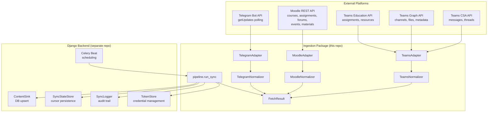
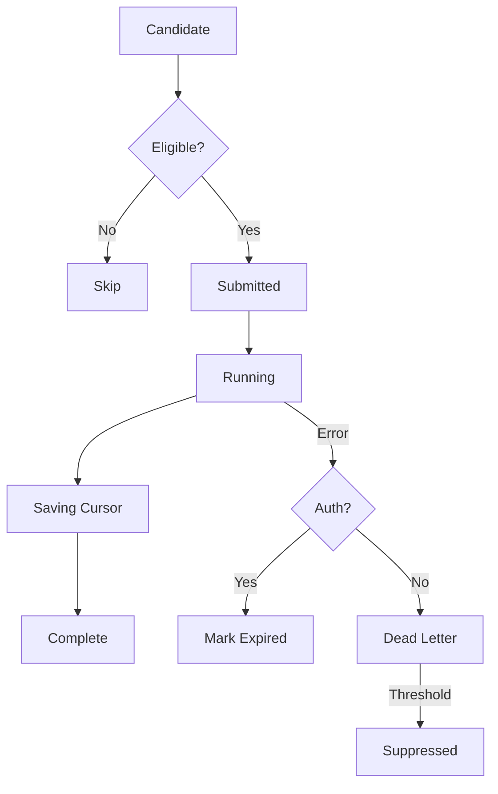

# Architecture Overview

> High-level architecture, data flow, design rationale, and package boundaries
> for the `endpoint-ingestion` pipeline.

---

## What This Is

A standalone Python package that fetches academic content from three platforms
(Microsoft Teams, Moodle, Telegram), normalizes it into a unified schema
(`NormalizedItem`), and returns structured results to the caller.

**It is NOT a Django app.** It has zero database dependencies, zero scheduling,
zero file downloads. It is a pure async library: credentials + cursor in,
`FetchResult` out.

**Target deployment:** Constructor University, ~2,500 students.

---

## System Diagram



---

## Data Flow

```
1. TRIGGER     Django/Celery fires a sync task for (user_id, platform)
                        │
2. CREDENTIALS  TokenStore.get_credentials() → dict
                        │
3. CURSOR       SyncStateStore.get_cursor() → dict | None
                        │
4. FETCH        adapter.fetch(credentials, cursor, scope) → FetchResult
                  ├── HTTP calls to platform APIs
                  ├── Raw responses wrapped in RawPayloadEnvelope
                  └── Normalized to NormalizedItem list
                        │
5. UPSERT       ContentSink.upsert_batch(items) → item_ids
                        │
6. CURSOR SAVE  SyncStateStore.set_cursor() — only on full completion
                        │
7. LOG          SyncLogger.log_complete(sync_id, stats)
                        │
8. RETURN       SyncStats to caller
```

**Key invariant:** Cursor is only persisted on full completion. Partial failures
do not advance the cursor — the next run re-fetches from the last successful
checkpoint.

## Adapter Normalization Filters

Adapters own platform-specific noise filtering before returning
`NormalizedItem` records. This keeps processor classification platform-agnostic
and prevents deterministic system artifacts from consuming downstream work.

- **Teams:** `TeamsNormalizer` drops observed non-content CSA and Graph events,
  including call start/end blobs, bare `Scheduled a meeting` messages,
  `RichText/Media_CallRecording` recording cards, bare
  `Meeting in GeneralPlay` recording placeholders, escaped or unescaped CSA JSON
  blobs containing `scopeId`, `storageId`, or `callId`, assignment/app card
  placeholders such as
  `go.skype.com/cards.unsupported`, and Graph `systemEventMessage` rows. It also
  excludes Teams-internal links such as `*.flightproxy.teams.microsoft.com`,
  `*.conv.skype.com`, and `go.skype.com/cards.unsupported`.
- **Moodle:** the Moodle adapter skips assignment due calendar events
  (`eventtype=due`, `modulename=assign`, `component=mod_assign`) because the
  assignment API already provides the canonical assignment item.

---

## Sync lifecycle

A sync moves through these states once dispatched. The scheduler tick
classifies a (user, platform) pair as a candidate; the worker pool
runs the dispatched ones; the pipeline persists the cursor on
clean completion only.



| State | Owner | Meaning |
|-------|-------|---------|
| Candidate | Scheduler | Tick discovered the (user, platform) pair. |
| Skip | Scheduler | `why-not-running` reason emitted (paused, cooldown, dead-letter, expired creds, worker-saturated, disabled platform). |
| Submitted | Worker pool | Dispatched but waiting for a free slot. |
| Running | Pipeline | `adapter.fetch()` is in flight. |
| Saving Cursor | Pipeline | `set_cursor` only on full completion. |
| Complete | Pipeline | `SyncStats` returned, `log_complete` written. |
| Mark Expired | Credential refresher | `auth_expired` → user must re-link. |
| Dead Letter | Pipeline | Non-auth error; counter increments per (user, platform, code). |
| Suppressed | Pipeline | Threshold reached; scheduler stops generating candidates until a clear / replay command. |

`why-not-running` (admin endpoint) reports the Skip reason for any
candidate the scheduler refuses to dispatch.

---

## Token Relay Architecture

The mobile app captures auth tokens from native login flows, sends them to the
Django backend, and the backend polls platform APIs server-side.

```
Mobile App  ──(tokens)──►  Django Backend  ──(API calls)──►  Platform APIs
                               │
                          Ingestion Package
                          (stateless library)
```

The ingestion package never performs authentication. It receives credentials as
plain dicts and uses them as Bearer tokens.

**Teams special case:** After an initial interactive MFA login (Playwright-based),
headless token refresh is permanent via SSO cookie rotation. The user never logs
in again. See `V2.1.0-Breakthrough.md` for the full token lifecycle.

---

## Ingestion Modes

| Mode | How it works | Platforms |
|------|-------------|-----------|
| Server-side polling | Backend calls `adapter.fetch()` on a schedule | Teams (CSA + Graph + Assignments), Moodle (REST API), Telegram (`getUpdates`) |

All platforms currently use `server_poll`. Client-side push (`client_push`)
is reserved for future mobile-initiated sync but not yet implemented.

### Recommended polling cadence

| Platform | Scope | Cadence | Rationale |
|----------|-------|---------|-----------|
| Teams | `messages` | Every 5 min | Chat messages update frequently |
| Teams | `assignments`, `files` | Once daily | Structural data changes rarely |
| Moodle | All scopes | Every 15 min | REST API is reliable, data changes slowly |
| Telegram | `messages` | Every 1-2 min | Bot API is lightweight |

---

## Package Boundary

The ingestion package is **explicitly stateless**. Here is what it does and does not do:

| Responsibility | Owner |
|---------------|-------|
| HTTP calls to platform APIs | **Ingestion** |
| Normalization (raw → NormalizedItem) | **Ingestion** |
| Retry, backoff, rate limiting | **Ingestion** (BaseHTTPClient) |
| Error classification (FetchError codes) | **Ingestion** |
| Scheduling sync runs | **Django/Celery** |
| Token refresh | **Django** (or CLI for dev) |
| File downloads + S3 storage | **Django** |
| Cross-platform dedup | **Django** |
| LLM extraction (Telegram) | **Django** (separate pipeline stage) |
| Group-to-course mapping | **Django** |
| Notifications | **Django** |
| Database reads/writes | **Django** (via Protocol implementations) |

---

## Architectural Layers

```
┌─────────────────────────────────────────────────┐
│  pipeline.py — run_sync() orchestrator          │
│  Entry point for Django/Celery                  │
├─────────────────────────────────────────────────┤
│  ports.py — Protocol interfaces                 │
│  Adapter, TokenStore, ContentSink,              │
│  SyncStateStore, SyncLogger                     │
├─────────────────────────────────────────────────┤
│  adapters/ — Platform-specific fetch + normalize│
│  ├── base.py      BaseAdapter (scope, creds)    │
│  ├── teams/       CSA + Graph + Assignments     │
│  ├── moodle/      REST API                      │
│  └── telegram/    Bot API                       │
├─────────────────────────────────────────────────┤
│  clients/ — Shared HTTP infrastructure          │
│  ├── base.py      BaseHTTPClient (retry, rate)  │
│  └── http.py      AsyncHTTPClient (OData, etc.) │
├─────────────────────────────────────────────────┤
│  schemas.py — Pydantic models & enums           │
│  config.py  — Pydantic Settings                 │
│  exceptions.py — Exception hierarchy            │
│  normalize.py — Shared normalizer helpers        │
└─────────────────────────────────────────────────┘
```

Dependencies flow downward only. Adapters depend on schemas/clients/normalize.
Pipeline depends on ports. Nothing depends on Django.

---

## Design Decisions

Decisions are numbered for cross-reference. Captured 2026-03-12, refined through
v2.0 and v2.1 refactors.

### Auth & Token Strategy

| # | Decision | Rationale |
|---|----------|-----------|
| 1 | Auth is fully external | Package receives `credentials: dict`. No Playwright, no JWT decode, no token manager inside the package. |
| 4 | Team IDs provided by caller | Adapter never discovers teams on its own. Caller passes team IDs in credentials. |
| 26 | Token storage in `~/.config/endpoint/` (CLI) | Overridable via `--auth-dir`. Never in project directory. |

### Teams Architecture

| # | Decision | Rationale |
|---|----------|-----------|
| 2 | CSA + Graph are complementary, not fallbacks | CSA fetches messages/threads. Graph fetches structural data (channels, files, assignments). Both run in parallel via `asyncio.gather()`. |
| 3 | Graceful CSA-only degradation | If Graph token expired but CSA alive: messages still flow. Graph-dependent features skip with warnings. |
| 5 | Semester-aware initial sync | Configurable `semester_start` in config. Falls back to rolling 90 days. Never fetches last semester's content. |
| 7 | CSA continuation token cursor | Per-channel `continuationToken` for incremental message fetching. Token invalidation triggers full re-fetch. |
| 10 | Single `fetch()` with scope parameter | Caller controls granularity: messages every 5 min, structural data once daily. |

### Moodle Architecture

| # | Decision | Rationale |
|---|----------|-----------|
| 6 | Semester start config | Same pattern as Teams. 90-day rolling fallback. |
| 12 | Dual incremental strategy | Calendar events API for deadlines. Course updates API for materials/forums. |
| 13 | Course filtering: auto + override | Auto-filter by `startdate`/`enddate`. Caller can override with explicit list. |
| 14 | Forum scope configurable | `"announcements"` (default) or `"all"`. |
| 15 | File filtering by extension | Skip media extensions. Still include `FileRef`s — tagged so Django can decide. |

### Telegram Architecture

| # | Decision | Rationale |
|---|----------|-----------|
| 16 | Privacy mode OFF required | Documented prerequisite. Bot must see all group messages. |
| 17 | Edits are updates | `edited_message` processed with same `external_id`. Upsert overwrites. |
| 18 | Group mapping is Django's job | Adapter passes `chat.id` + `chat.title`. All group-to-course mapping lives in Django. |
| 19 | Forwarded messages: full attribution | Original author as `author`. Forwarder info preserved in `raw_payload`. |

### Data & Normalization

| # | Decision | Rationale |
|---|----------|-----------|
| 9 | HTML stripping in normalizer | `body` = plain text (always present). Original HTML stays in `raw_payload`. |
| 20 | No cross-platform dedup | Handled downstream by Django. Ingestion keeps items from different platforms separate. |
| 24 | Cursor saves on full completion only | No partial cursor saving. Crash = full re-fetch. Simple, no partial state corruption. |
| 30 | Pure stateless function | `credentials + cursor in → FetchResult out`. Zero side effects beyond HTTP calls. |

### Error Handling & Observability

| # | Decision | Rationale |
|---|----------|-----------|
| 22 | Structured `FetchError` model | `code` (enum), `message`, `scope`, `recoverable`, `timestamp`. Django can programmatically decide retry vs notify vs skip. |
| 23 | Per-instance rate limiting | Package enforces per-adapter rate limits. Cross-user coordination is Django's concern. |
| 29 | Enriched `SyncStats` | Timing breakdowns (`api_call_duration`, `normalization_duration`), per-scope stats. |

### Package & Build

| # | Decision | Rationale |
|---|----------|-----------|
| 27 | Version from `pyproject.toml` | `adapter_version` in `RawPayloadEnvelope` pulled automatically. Single source of truth. |

---

## Tech Stack

| Component | Technology |
|-----------|-----------|
| Language | Python 3.12+ |
| HTTP client | httpx (async) |
| Data models | Pydantic v2 |
| Configuration | pydantic-settings |
| Build system | hatchling (via uv) |
| Type checking | pyright (strict mode) |
| Linting | ruff |
| Testing | pytest + pytest-asyncio + respx |
| CLI (dev only) | typer + rich + playwright |

---

## Related Documentation

| Doc | What it covers |
|-----|----------------|
| [SCHEMA.md](SCHEMA.md) | Every model, enum, protocol, and config field |
| [CONNECTORS.md](CONNECTORS.md) | Per-platform API details, data mapping, quirks |
| [CONVENTIONS.md](CONVENTIONS.md) | Code patterns, naming, error handling standards |
| [ADDING_A_CONNECTOR.md](ADDING_A_CONNECTOR.md) | Step-by-step guide for new platforms |
| [INTEGRATION_GUIDE.md](INTEGRATION_GUIDE.md) | Single-file context for Django integration |
